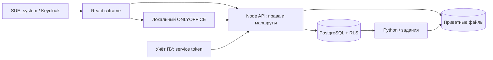
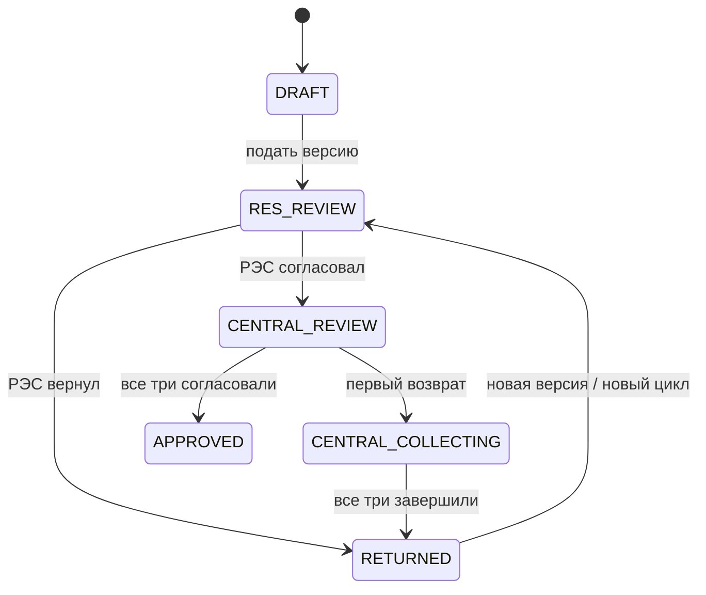

# Контекст TP_Approval

## 04.11.2026 — Email, корректировка и удаление учёток
Пользователь подтвердил запуск приложения на Amvera и попросил email для будущей привязки Keycloak, исправление и удаление учёток. От main f0f0cde подготовлена feature/account-email-management: обязательная почта новых сотрудников (trim/lowercase/unique), редактирование ФИО/логина/email/ролей/РЭС, подтверждаемое удаление. Старые email остаются NULL до заполнения; новые адреса не угадываются. Подключение SUE_system исследовано только чтением: AuthProvider передаёт email, sub и realm roles; его код/настройки не менялись, автоматическая привязка по почте здесь не реализуется.
Миграция016 сохраняет users UUID и историю; удаление закрывает users и стирает local_credentials/сеансы, роли отзываются с сохранением assignment_id. Собственное удаление/снятие TECH_ADMIN запрещено; открытые задачи и неистёкшие замещения блокируют удаление/снятие соответствующей роли. Запись профиля проверяет account_revision, изменение логина/email/ролей отзывает сеансы. Для обновления действующей БД временно нужен прежний MIGRATION_DATABASE_URL; без016 только панель учёток выдаёт понятную ошибку, вход/документы не блокируются. Подробности, проверки и следующий шаг — верх PROGRESS.

## 04.11.2026 — Сохранение выбранных паролей при запуске Amvera
После запуска версии874fb62 пользователь потребовал сохранить свои пароли. Убран только отдельный минимум16 символов для пароля БД в setup-standalone: пароль должен быть непустым, логин runtime по-прежнему tp_runtime. Учётную запись создаёт подготовка; пароль берётся из DATABASE_URL. Владелец/суперпользователь используется только в MIGRATION_DATABASE_URL. Для неверного логина и пустого пароля теперь разные сообщения. Политика веб-паролей (от12символов), RLS и ограничения runtime сохранены. Локально прошли build, build:setup и34 unit; штатный браузерный сценарий теперь вызывает реальную подготовку дважды с синтетическим11-символьным паролем БД. Итог нативного CI/слияния фиксируется в GitHub PR этой ветки. Реальные значения со скриншотов не сохраняются в репозитории.

## 04.11.2026 — Самостоятельный вход и подготовка Amvera
Пользователь отложил интеграцию платформы и отдельно выбрал «Реальная работа», а не демостенд. На ветке feature/standalone-amvera от main 0eaef4c реализован AUTH_MODE=local: логин/пароль, обязательная замена временного пароля, сессии в БД/HttpOnly cookie, экран TECH_ADMIN для создания сотрудников, назначения ролей, сброса паролей и закрытия доступа. Миграция015 добавляет отдельные учётные данные/сессии, не переписывая пользователей Keycloak, документы и историю. SSO-режим сохранён, код SUE_system не менялся.
Dockerfile/amvera.yml/entrypoint/setup-standalone готовят отдельную БД, первого администратора и постоянный /data/storage. Первый старт: DATABASE_URL, MIGRATION_DATABASE_URL, INITIAL_ADMIN_PASSWORD; служебные два секрета затем удаляются. Без ClamAV допускается вход/настройка/чтение, но обе загрузки в production блокируются; это перенос проверки наличия сканера с запуска на приём файла, не отмена проверки документов. Для согласования всё ещё нужны назначения и утверждённый календарь. Инструкция — STANDALONE_AMVERA.md.
Build, build:setup и 33 unit прошли локально и в GitHub Actions. Штатный CI на коммите 5c08b46 также успешно выполнил 75 прежних и 6 новых интеграционных групп с нативным PostgreSQL17.11, 4 группы настоящего Chromium с HTTPS и перезапуском БД/API, сборку Docker. Локальная дополнительная проверка с PostgreSQL18.6/WASM остаётся отдельной; ограничение native initdb в локальной среде больше не мешает приёмке в CI. Живая Amvera/ClamAV и работа постоянного тома в Amvera ещё не проверены. Полные факты — верх PROGRESS.
Пользователь 04.11.2026 попросил выполнить действия в GitHub самостоятельно: публикацию изменений, проверки и обновление основной ветки после успешной проверки. Отдельный токен в чат не нужен. Ветка опубликована, результат проверок и слияния отслеживается в PR №2: https://github.com/ashinoff/TP_Approval/pull/2. Обновлять main только после успешных проверок актуального head. Следующий этап — настройка отдельного приложения Amvera по STANDALONE_AMVERA.md; развёртывание в текущей задаче GitHub не выполнялось. Локальные ключи, пароли, WASM-БД и screenshots остаются только в игнорируемой .local.

## 04.11.2026 — Предоставленный патч рабочего места и сверки V4
Текущая ветка feature/archive-tu-v4-20261104 в отдельном worktree .local/patch-review, база origin/main d6c6adf. Исходные39 файлов пользовательского архива сохранены коммитом e42bdcb без изменения программного кода. Здесь другая версия интерфейса, чем локальная feature/document-workplace; её изменения не смешивались с патчем. Архив содержит V4/ручные подтверждения и миграцию014, её применять только штатным мигратором; уже применённые001–013 не изменялись.
Фактически пройдены build/typecheck,32 unit и75 integration на изолированном PostgreSQL. Браузерные/persistence этой ветки не выполнялись; существующий стенд на5173 продолжает работать с прежним кодом корневой ветки. Подробности/проверки/ограничения — PATCH_IMPORT.md и верх PROGRESS, не переносить результаты предыдущего интерфейса на этот архив.
Пользователь явно запросил push отдельной ветки и PR в main, без автоматического merge/деплоя. Следующий шаг — опубликовать/проверить PR, затем браузерная регрессия именно этой ветки перед слиянием. Папки «патч»/«промт», реальные документы, ключи, локальные БД/отчёты не публикуются.

## Последнее уточнение 03.11.2026 — Простое создание и исправление 415
Одна кнопка «Создать документ» открывает форму, внутри — «Сохранить документ». Убрано дублирование кнопки реестра. Если ТУ распознали номер договора, сохранение пакета с актом возможно без неизвестных даты договора/заявителя/адреса; дата создания остаётся текущей. Миграция 013 применена к demo: contract_date допускает NULL, уникальность/привязка неизвестных дат учитывает NULL, история не переписывается. Неполные реквизиты пока можно заполнить до сохранения; отдельного редактора реквизитов после создания нет.
extract-tu безопасно подготавливает ТУ с локальной file-ссылкой attachedTemplate: удаляются только два XML-узла связи, остальные части пакета проверяются побайтно, результат проходит строгий validateDocx; UI уведомляет и отправляет подготовленную копию. Не применяет преобразование к поданным версиям/актам. Другие внешние связи, удалённые шаблоны, подписанные преобразуемые пакеты и опасное содержимое отклоняются. Проверка исходного реального ТУ в Chrome дала 200 и реквизиты, без сохранения в БД. Краткое описание ПО — SOFTWARE_SUMMARY.md. Пользователь явно разрешил отправить код и контекст в GitHub; это разрешение не является разрешением на деплой или публикацию реальных документов.

## Актуально 03.11.2026 — Создание документа из ТУ
Единое «Создать документ»: номер нового акта равен номеру договора; ТУ предлагают номер, заявителя, адрес и явно указанную дату договора, значения проверяемы инженером. Текущая дата — дата создания, не дата договора. Пакет использует существующие contracts, UUID и отдельные версии; старые номера/ссылки не переписываются, act_id не объединяются. Имена скачивания: номер + АКТ ТП/АВТУ/ТУ. Переключатель документов пакета в рабочем месте; ТУ только для просмотра. Схема/ПСУ/предыдущий акт пока не реализованы. RLS/маршрут/сверка/замещение/история сохранены. См. TU_IMPORT.md и последнюю запись PROGRESS.md для проверок.

## Актуально 03.11.2026 — Рабочее место инженера завершено
Четыре меню upload/progress/corrections/approved: форма загрузки и черновики, текущие согласования, возвраты/пересмотр/отозванные, действующие публикации. При пересмотре текущая публикация сохраняется в approved. Обязательная серверная проверка ТУ по пяти реквизитам, точным единицам и реальным DOCX; отчёты immutable/RLS, привязаны к версиям/хешам/правилам DOCX_CONTEXT_V3; прямой submit защищён. Миграция 012 применена, не редактировать. UNKNOWN и MANUAL_REVIEW пока блокируются; ручного обхода нет, таблицы/неизвестные шаблоны могут не распознаться. Это не универсальная экспертиза. Роли и маршрут предыдущего этапа сохранены. Пройдены build, 21 unit, 71 integration, 74 Chrome-группы, пять persistence после restart. Подробности ENGINEER_WORKSPACE.md и начало PROGRESS.md. Старые записи ниже «В работе» исторические.

## 02.11.2026 — Четыре меню инженера и обязательная сверка — В работе
Последнее задание: загрузка / на согласовании / не согласованные / согласованные. Реализованы новые серверные view/counts upload/progress/corrections, меню и форма EngineerUpload; legacy preparation остаётся только для совместимости. Действующий порядок согласования не меняется. Миграция 012 добавляет обязательную проверку ТУ по умолчанию (также к существующим актам при будущей отправке), immutable app.tu_checks, защиту флага и отображение уже разрешённых временных ролей в /me. Введены локальные DOCX_CONTEXT_V1 правила пяти реквизитов с точными единицами/обеими цитатами; submit защищён сервером от отсутствующего/устаревшего/неуспешного отчёта. UNKNOWN и MANUAL_REVIEW пока тоже блокируются, ручной обход не реализован. Подробности и важные ограничения ENGINEER_WORKSPACE.md. Уже пройдены 19 unit и 71 integration; браузерная проверка нового интерфейса пока не выполнена. Миграция 012 применяется к demo при запуске, после применения не менять. Актуальный шаг — новые Playwright-сценарии и регрессия, затем restart/контекст.

## 02.11.2026 — Уточнение пользователя: инженер и первый согласующий РИРУ
Актуальный маршрут: Инженер РИРУ своего РЭС подготавливает/загружает/дорабатывает; Начальник РИРУ того же РЭС согласует первым; Начальник РЭС — вторым; СТП, СУЭ и ТЕХБЛОК — параллельно. Это явное изменение бизнес-правил пользователем, заменяет прежние описания загрузки Начальником РИРУ. Код ТЕХБЛОКА остаётся GI. Роли, сроки, история и миграция описаны в ROLES_WORKFLOW.md.
Реализованы RIRU_ENGINEER, RIRU_REVIEW, версии маршрута и пять строк матрицы нового цикла. Старые циклы workflow_version=1 сохраняют прежние четыре согласующих; последующие циклы всегда version=2. Прежние назначения загрузчика преобразованы в инженера с сохранением UUID/замещений. Для нового Начальника РИРУ нужно отдельное назначение. Новая предварительная норма первого этапа — 1 рабочий день; остальные нормы сохранены. Доработка возвращается инженеру. Локальные аккаунты: riru-adler / riru-head-adler / chief-adler, аналогично Хостинский РЭС. Этап завершён: build, 16 unit, 65 integration, 67 Chrome-групп и четыре persistence после полного restart. Миграции 010/011 применены; не редактировать. Фактические проверки, ограничения и следующий шаг — начало PROGRESS.md.

## 02.11.2026 — Типизированный комплект договора
Реализованы миграция 009, app.contracts и app.technical_conditions, явный выбор ТУ / Акт ТП / АВТУ в загрузке РИРУ. АВТУ — альтернативный вид акта с прежним полным маршрутом; ТУ не создают версий акта/задач согласования. Группировка договора: РЭС + нормализованный строковый номер + дата договора; нули/суффиксы сохраняются, карточки act_id раздельны. Разные даты или РЭС не объединяются автоматически; будущему lookup нельзя игнорировать неоднозначность.
Редакции ТУ хранят собственные номер/дату отдельно, доступны в компактной панели рабочего места с защищённым предпросмотром/скачиванием. При подготовке можно выбрать редакцию ТУ другого акта того же договора. На submit цикл фиксирует текущую ссылку ТУ; новые загрузки и выбор не меняют старые циклы. Старые циклы до миграции остаются без ссылки, история не выдумывается. Вид акта фиксируется с первой версией, другой вид оформляется отдельной карточкой договора. Отсутствие ТУ пока не вводит новое блокирующее правило отправки.
API и БД запрещают ТУ вместо версии акта и изменение ссылок ТУ закрытого/идущего цикла. RLS новых таблиц сохраняет область РЭС и исключение TECH_ADMIN. Файлы остаются приватными; имена выгрузки содержат тип/договор/редакцию, исходные байты не переписываются. PDF/распознавание/производственная автоматическая сверка пока не реализованы; локальное исследование примеров отдельно от рабочего импорта. Подробности CONTRACT_DOCUMENTS.md. Проверки завершены: build, 15 unit, 59 integration, 61 Chrome browser-группа и три persistence после полного restart. Детали, ограничения и следующий шаг — начало PROGRESS.md.

## История исследования 02.11.2026 — до реализации комплекта
Последующее уточнение пользователя: при загрузке РИРУ выбирает «ТУ» / «Акт ТП» / «АВТУ». Акт ТП и АВТУ альтернативны: комплект ТУ + выбранный вид акта, оба вида не являются одновременно обязательными. Не строить совместный обязательный цикл двух актов. Переключатель типа/новая загрузка в API ещё не реализованы; не считать эту запись готовой функцией. Детали в CONTRACT_DOCUMENTS.md.
Пользователь уточнил: главным деловым ключом является номер договора ТП, по нему объединяются ТУ, АВТУ (отдельный тип — акт выполнения технических условий) и акт ТП; он же будет основой будущей синхронизации с учётом ПУ. Сохранять самостоятельные UUID/версии документов и собственные номера ТУ/актов: номер договора не подменяет их. Общая карточка договора не схлопывает разные act_id и не ослабляет RLS. Детали — CONTRACT_DOCUMENTS.md.

Локально изучены два предоставленных реальных DOCX (ТУ и АВТУ); отдельного акта ТП в папке нет. Разовая проверка Python/XML/Decimal без ИИ подтвердила совпадение договора, адреса, полной/существующей/дополнительной мощности, напряжения, обозначения ТП, питающего центра и чисел из таблицы АВТУ. Полная эквивалентность текстов точки присоединения не доказана — MANUAL_REVIEW. Распределение мощности по категории надёжности требует учёта полной/добавляемой мощности, не прямого сравнения цифр. Исходники и извлечённые реквизиты остаются только локально вне Git; папка примеров исключена целиком. В приложение загрузка ТУ/АВТУ, карточка договора и эти проверки ещё не интегрированы; БД/workflow не менялись. Маршрут АВТУ и связь его цикла с актом ТП требуют отдельного бизнес-уточнения, ничего не переносить автоматически.

## Актуальная навигация — 01.11.2026
По новому заданию пользователя принята рабочая навигация: согласующий входит в «На согласование» (только его эффективные открытые задачи), «Все в работе» — вторичный переключатель. «Согласованные» определяется CURRENT/UNDER_REVISION публикацией, не display_status; скачивается утверждённая редакция. Для РИРУ — «Подготовка актов», без исчезновения между незавершёнными этапами. Счётчики разделов отделены от платформенного badge (включает доработку) и unread уведомлений (колокольчик).

Одна карточка /#/acts/{act_id}?section=queue|work|preparation|approved сразу открывает документ/замечания и единственные действия. ActDocument содержит общие controls подготовки внутри WordWorkspace, дублирующая вкладка и select решений удалены. Подтверждение решения показывает версию; server проверяет переданный versionId против заблокированной задачи. Старая версия — только просмотр. RLS/замещение/самосогласование/история/workflow не менялись. CENTRAL_COLLECTING показан как «Сбор замечаний», RETURNED как «На доработке», просрочка отдельным флагом, в том числе в матрице.

Реестр: шесть колонок, договор/акт ссылкой по act_id, вся свободная область строки открывает карточку, два действия «Открыть»/«Ещё». Основная дата и фильтр — contract_date с новым dateField=contract; legacy created_at API не переименован. Состояние списка отдельно по пользователю/разделу (поиск/фильтры/page/scroll); hash-маршруты, Back/F5, повторная авторизация. Документ/ввод не сбрасываются polling; уход с несохранённым замечанием требует подтверждения. Подробная принятая спецификация — REGISTRY_UI.md; фактическая проверка и следующий шаг — начало PROGRESS.md. Более старые описания двух вкладок/восьми кнопок ниже исторические.

## Актуализация 01.11.2026 — Интерактивные DOCX, прототип
Во вкладке «Документ» работает локальный docx-preview-прототип с явной маркировкой приблизительной HTML-вёрстки. Выделение внутри однозначного абзаца, категории/предложения/красные маркеры, двусторонняя навигация, прежний контроль устранения и текстовый diff работают на фактических DOCX/БД. Источники неизменны, anchor проверяется сервером по SHA-256 и точному OOXML-тексту; на новые версии не переносится. Миграции 007/008: категории, метаданные замечаний, снимки авторов, append-only history и защищённое администрирование словаря. Просмотры/скачивания/сравнения аудируются. Согласование собственных замечаний текущей версии блокируется: требуется возврат; параллельный маршрут не изменён. Печать карточки удалена из действий, чистовая/служебная печать недоступны. ONLYOFFICE не запущен (нет Docker/WSL/Document Server); не считать этап точного редактора завершённым. Подробности лицензии, тестов и продолжения: [DOCX_PROTOTYPE](DOCX_PROTOTYPE.md).

## Актуализация 01.11.2026 — Реестр и карточка
Реализованы серверный реестр с поиском/фильтрами/пагинацией/сводками, компактный маршрут в строках, SVG-действия с реальными решениями, summary карточки, подробный маршрут и хронология с переходами к замечаниям/версиям/матрице цикла. Источник — реальные таблицы под RLS; бизнес-переходы и badge не менялись. Новая миграция 006 сохраняет личности audit-событий, не копирует статусы. Старые неизвестные исторические имена не восстанавливаются предположениями. Карточка читает агрегат в repeatable-read read-only транзакции. Детали, API и ограничения: [REGISTRY_UI](REGISTRY_UI.md). Печать только карточки, полный Word/PDF-пакет ещё не реализован. Проверки и следующий шаг — в начале PROGRESS.md.

Обновлено: 31.10.2026. **Архитектура утверждена пользователем с уточнениями; реализуется этап 2.** Фактические функции и запуск — в [CORE_STATUS](CORE_STATUS.md). Ниже описана целевая система; наличие функции в этом документе не означает завершённую реализацию. Источники платформы — в [исследовании](SUE_SYSTEM_REVIEW.md); фактическая схема — в db/migrations, целевая — в DATA_MODEL.

## Матрица согласования — реализована 31.10.2026
В карточке есть отдельная вкладка «Матрица согласования»: Начальник соответствующего РЭС, СУЭ/СТП/ГИ; ФИО, статусы с цветом/текстом/значком, даты поступления/решения, сохранённый норматив/due_at, календарная длительность, комментарии по нажатию на счётчик, просрочка и общий итог. Текущая Word-версия/цикл и выбор прошлых циклов восстанавливаются после F5/входа как UI-предпочтения sessionStorage.

API GET /api/v1/acts/{id}/approval-matrix?cycleId=uuid — один SQL snapshot фактических tasks/decisions/cycles/versions/comments/releases под RLS. Отдельной таблицы статусов нет; уведомления/badge/workflow не менялись. В открытой видимой вкладке polling раз в 5 секунд и при фокусе, без reload страницы. Миграция 005 добавляет только снимки назначенного/закрывшего задачу сотрудника и запрет изменения закрытых задач; старые решения сохраняют уже записанный actor_name. Старое отсутствие ФИО при отмене невозможно восстановить точно, помечено LEGACY_ASSIGNEE.

Подробности, приоритет итогов и ограничения: [APPROVAL_MATRIX](APPROVAL_MATRIX.md). Проверки: build, 6 unit/security, 16 прежних + 10 новых интеграционных групп, 10 новых и 16 существующих Playwright-групп. Матрица проверена в настоящем Chrome, включая замещение, историю, отзыв и отсутствие решения. Следующая сессия должна учитывать миграцию 005; не редактировать применённые миграции и не возвращать функциональность к статическому макету.

## Локальная браузерная проверка — актуальное состояние
31.10.2026 подготовлен и запущен отдельный синтетический стенд: frontend http://127.0.0.1:5173, API :3000, тестовый JWT/JWKS :4100, изолированный PostgreSQL 17.11 :55432/tp_approval_demo. Используется штатная проверка RS256/JWKS и RLS, подменён только провайдер входа; боевой Keycloak и SUE_system не подключались. Все порты loopback. `npm run demo` игнорирует .env и внешние подключения; NODE_ENV=production запрещает этот launcher.

Реально запущен headless Chrome 156.0.8078.48 через Playwright: 9 отдельных сессий, 16 групп браузерных проверок полного цикла/возврата/исправления/согласования, приватности/уведомлений/badge, сроков и мобильного viewport. Проверено сохранение данных после F5/повторного входа и полного перезапуска PostgreSQL/API/JWT/Vite. Пример: БРАУЗЕР-1793476608991, APPROVED, 2 версии, 2 цикла, 8 решений. Отчёты и screenshots в .local/browser-report, пользовательская инструкция — [LOCAL_BROWSER_GUIDE](LOCAL_BROWSER_GUIDE.md).

Исправлены лишние запросы открытия/обновления, вызывавшие HTTP 429 при интенсивном прогоне, и доступное имя поля решения. Лимиты сохранены: общий IP 600/мин, персональный 180/мин. Добавлены выход/смена пользователя, русские ошибки, история решений/имя автора, сроки РИРУ/реестра, видимые красные/зелёные замечания и форма исправления без prompt. UI не показывает чужим авторам подтверждение замечания и не предлагает повторную подачу старой версии. Бизнес-маршрут не менялся.

Следующая сессия: прочитать верхнюю запись PROGRESS, проверить здоровье оставленного стенда; при остановке запустить `npm run demo`, сохранив .local/demo.json и указанный там cluster. Не принимать учебный календарь будней за официальный производственный календарь. Реальный SSO, ClamAV, Word GUI/ONLYOFFICE и эксплуатационный контур не проверены. Продолжить оставшиеся задачи этапа 2, затем прототип редактора; повторное разрешение на локальный синтетический стенд уже дано пользователем.

## Утверждённые уточнения пользователя от 31.10.2026
- Центральные подразделения завершают проверки независимо после первого RETURN. После истечения сроков оставшихся задач PROCESS_ADMIN своей области может закрыть сбор с причиной и вернуть акт. Отсутствие решения не является согласованием.
- Назначения по роли/подразделению/РЭС, временное замещение с началом и окончанием. Запрещены самосогласование и два решения одним пользователем в разных ролях одного цикла.
- РИРУ сообщает, что исправлено; автор замечания подтверждает устранение при повторном согласовании. История неизменяема.
- Badge считает уникальные акты с активной персональной задачей, включая доработку и просроченные задачи. Непрочитанные сообщения считаются отдельно.
- Предварительные нормативы: RES_HEAD — 1 рабочий день; SUE/STP/GI — по 2 параллельно; RIRU_HEAD — 2. Нормативы настраивает администратор процесса.
- TECH_ADMIN управляет пользователями/ролями без автоматического доступа к содержимому. PROCESS_ADMIN управляет сроками, замещениями и исключениями в назначенной области (res_id; NULL означает явное глобальное назначение), но не подменяет согласующих.
- Пересмотр утверждённого акта: новая версия и полный цикл; старая публикация сохраняется. CURRENT — актуальная, UNDER_REVISION — утверждённая в пересмотре, SUPERSEDED — заменена, REVOKED — отозвана с причиной.
- ONLYOFFICE — основной кандидат до проверки реальных DOCX, лицензии/API, якорей, комментариев и форматирования.

Начальная техническая трактовка ядра: на роль/область требуется один однозначный исполнитель с учётом замещения; неоднозначность даёт 409, а не случайный выбор. Срок — та же московская отметка времени на N-й рабочий день после даты поступления; отсутствие полного календаря блокирует операцию. Рабочие интервалы и правило первого дня надо уточнить до эксплуатации. При пересмотре прежнее утверждение не отзывается автоматически; будущий внешний API должен учитывать UNDER_REVISION явно и исключать REVOKED/SUPERSEDED. Окончательная схема импорта ПУ ещё не согласована.

## Назначение и объём
Автоматизировать согласование актов технологического присоединения Сочинского ПЭС: реестр актов и договоров, загрузка DOCX и ТУ (PDF/DOCX), последовательное и параллельное согласование, замечания к фрагментам, исправления, неизменяемая история версий, производственный календарь и нормативы, персональные задачи и уведомления, печатные пакеты DOCX/PDF, аналитика/Excel, выдача утверждённых структурированных данных программе учёта ПУ, помощь в сверке с ТУ. Система самостоятельна, платформа SUE_system даёт SSO и оболочку iframe. Электронное согласование не является юридически значимой ЭП.

## Организация и роли
Семь РЭС: Краснополянский, Адлерский, Хостинский, Сочинский, Дагомысский, Лазаревский, Туапсинский. В каждом: Начальник РИРУ (`RIRU_HEAD`) и Начальник РЭС (`RES_HEAD`). Центральные подразделения: Служба учёта электроэнергии (`SUE`), Служба технологического присоединения (`STP`), технический блок (`GI`). Администраторы: `TECH_ADMIN` и `PROCESS_ADMIN`.

### Предлагаемая матрица прав
Доступ по умолчанию запрещён. Все права проверяются API и RLS, включая дочерние сущности, файлы, задачи, экспорт, аналитику. Центральные роли читают все семь РЭС, но решают только за своё подразделение и только активную задачу.

| Действие | РИРУ | Начальник РЭС | СУЭ / СТП / ГИ | Администратор |
|---|---|---|---|---|
| Чтение карточки/версий/замечаний | Свой РЭС | Свой РЭС | Все РЭС | Не предоставлено автоматически* |
| Создание карточки и загрузка | Свой РЭС | Нет | Нет | Нет |
| Исправление и подача версии | Ответственный своего РЭС* | Нет | Нет | Нет |
| Решение этапа РЭС | Нет | Свой РЭС, активная задача | Нет | Нет |
| Решение центрального этапа | Нет | Нет | Своё подразделение, активная задача | Нет |
| Комментарий/предложение | Свой доступ; замечания по задаче | Своя активная задача | Своя активная задача | Нет |
| Отметить исправление | Ответственный, новая версия | Нет | Нет | Нет |
| Подтвердить устранение | Нет | Автор/уполномоченный согласующий* | Автор/уполномоченный согласующий* | Нет |
| Реестр, аналитика, экспорт | Свой РЭС | Свой РЭС | Все РЭС | Только служебные настройки* |
| Пользователи, справочники, нормативы | Нет | Нет | Нет | Да |

Матрица выше сохраняет бизнес-права; колонка администратора относится к TECH_ADMIN. PROCESS_ADMIN дополнительно читает документы в своей области и управляет исключениями, но не принимает решения за специалистов. Подтверждает исправление только автор замечания. В ядре центральное подразделение кодируется ролью SUE/STP/GI. Keycloak admin не обходит серверные права.

## Предлагаемая архитектура
Модульный монолит Node.js/Express/TypeScript для транзакционной бизнес-логики; React/Vite/TypeScript для UI; PostgreSQL как источник истины, SQL-миграции и RLS. Отдельный Python worker для разбора и формирования документов/OCR. Фоновые задания, outbox и планировщик на PostgreSQL на первом этапе, без обязательного Redis. Бинарные файлы — приватное S3-совместимое хранилище (в dev допустим закрытый volume через тот же адаптер). ONLYOFFICE Docs в контролируемом контуре как кандидат редактора/просмотра, с обязательным техническим прототипом перед фиксацией.



Целевое дерево (фактический состав см. CORE_STATUS):
```text
apps/web/src/              auth, registry, tasks, act, comments, analytics, admin, theme
apps/api/src/              auth, access, acts, workflow, comments, deadlines,
                          notifications, contracts, integrations, audit, files
apps/worker/src/           outbox, notifications, deadline scheduler
services/documents/        Python: extraction, rendering, comparison, printing, OCR
packages/contracts/       OpenAPI и общие схемы валидации
db/migrations/            SQL, ограничения, RLS
db/seeds/                 РЭС, роли, категории; только синтетические dev-данные
tests/                    integration, security, concurrency, e2e, synthetic fixtures
infra/                    Docker, reverse proxy, dev/prod, backup/restore
docs/                     контекст, ADR, API, модель и проверки
```

## Маршрут и неизменяемость
Карточка: РЭС, номер/дата договора, номер акта, заявитель, адрес, created_at, автор, ответственный, версия, статус; дата создания и автор назначаются сервером. Структурированные технические данные хранятся в снимке версии, а не извлекаются заново при внешнем запросе.

1. `DRAFT`: РИРУ загружает DOCX и ТУ, заполняет поля; результат проверки файлов должен быть READY. Черновые сохранения редактора — отдельные ревизии, не циклы.
2. Submit фиксирует неизменяемую act_version, снимки реквизитов и ТУ, создаёт цикл `RES_REVIEW` и задачу Начальнику РЭС. В пределах одного акта один активный цикл.
3. Решение РЭС `APPROVE` закрывает задачу и атомарно создаёт три задачи в `CENTRAL_REVIEW`. `RETURN` с обязательным замечанием закрывает цикл `RETURNED` и создаёт задачу доработки РИРУ.
4. СУЭ/СТП/ГИ решают независимо: `APPROVE` или `RETURN`. Первый RETURN переводит цикл в `CENTRAL_COLLECTING` (сбор остальных решений); оставшиеся задачи действуют. РИРУ видит поступающие замечания, но не подаёт новую версию до закрытия цикла. При всех трёх APPROVE — `APPROVED`; при трёх завершённых решениях и хотя бы одном RETURN — `RETURNED`. Автоматического согласования по таймауту нет; PROCESS_ADMIN своей области может вернуть акт после просрочки оставшихся задач, сохранив их без решений.
5. После возврата создаётся новая версия: исправления, ответы на замечания, новый снимок данных. Повторная подача запускает **новый** цикл с этапа Начальника РЭС. Старые решения остаются только историей. Количество повторных циклов = max(0, число поданных циклов − 1).
6. После APPROVED создаётся publication/release точной версии и цикла. Пересмотр переводит CURRENT → UNDER_REVISION, акт → REVISING. После нового полного утверждения старая публикация SUPERSEDED, новая CURRENT. Отзыв PROCESS_ADMIN с причиной даёт REVOKED. Старая версия, снимок и решения не удаляются.



Карточка показывает последнее состояние, но история циклов — источник фактов. Просрочка и наличие замечаний — отдельные признаки, не конкурирующие статусы. Решение согласующего неизменяемо; открытые блокирующие замечания исключают APPROVE (предложение на утверждение). У каждого решения сохранены user_id, ФИО/роль/подразделение на момент решения, время сервера, version_id, cycle_id, task_id и замечания.

## Замечания, Word и сравнение
Все 12 исходных категорий: орфографическая; пунктуационная; техническая; несоответствие ТУ; ошибка в мощности; в точке присоединения; в наименовании питающего центра; в номере опоры; в реквизитах заявителя; в адресе; оформления; другое. Администратор редактирует/деактивирует категории; удаление использованных запрещено, историческое название сохраняется.

Каждое замечание: UUID, версия, цикл/задача, автор и подразделение (со снимками), категория, текст, исходное значение, исправление, привязка, дата, статус. История событий: OPEN → REPORTED_FIXED (РИРУ с указанием новой версии) → VERIFIED либо REOPENED; VERIFIED/REOPENED выполняет автор замечания в активном повторном согласовании. В минимальном ядре пока реализованы текстовые замечания возврата и события исправления; категории и привязка к фрагментам — этап 3. Замечание не удаляется из истории. Автоматически считать исправленным по изменению текста нельзя.

Сравнение вариантов:
| Вариант | Достоинство | Ограничение |
|---|---|---|
| Комментарии OOXML в DOCX | Переносимы с Word, якорь в документе | Сами по себе не дают защищённого веб-интерфейса, категорий и workflow |
| ONLYOFFICE в своём контуре | Нативный DOCX, таблицы, комментарии, рецензирование | Ресурсы, лицензия/редакция API, проверка совместимости и синхронизации |
| Собственный HTML-preview | Контроль интерфейса | Риск потери вёрстки, сложные якоря и пагинация; не годится как основной редактор |

Предлагается ONLYOFFICE + собственная БД замечаний, с OOXML-якорями и PDF-предпросмотром как резервным вариантом. Это **условный выбор**, не обещание полной совместимости: до этапа 3 проверить лицензию, API выбранной редакции, таблицы/шрифты/разрывы страниц, якоря, подсветку и round-trip на синтетических шаблонах. Согласующие не редактируют содержимое поданной версии. Для каждого согласующего отдельная производная review-копия с комментариями, исходный файл неизменяем. БД хранит канонические замечания; импорт из копий проверяется сервером и привязан к задаче/сессии. Клиентское событие не служит доказательством автора. Конкретный мост между категоризированным замечанием и якорем должен быть доказан прототипом; без него функция не считается готовой.

Якорь: хеш исходной версии, OOXML part, comment/bookmark id, paragraph/table/cell path, диапазон и цитата с контекстом. В PDF-производном дополнительно страница и координаты с идентификатором render. Перенос на новую версию только как предложенное сопоставление с уверенностью; неоднозначность требует ручной привязки. Красное выделение/маркер в просмотре; карточка автора и предлагаемого исправления. Сравнение двух доступных версий: структурный diff текста/таблиц и параллельные PDF, без перезаписи исходников; изменение форматирования требует визуальной проверки. python-docx не используется для пересохранения исходного акта целиком; только чтение и генерация новых листов.

## Сроки и уведомления
Нормативы версионируются для этапа/подразделения; первоначальные значения помечаются демонстрационными и не выдаются за утверждённые. Производственный календарь: рабочие/выходные/переносы, праздничные и при необходимости сокращённые интервалы, версия и источник/утверждение администратором. Нельзя считать рабочими днями просто понедельник–пятницу. UTC для событий, Europe/Moscow для расчёта и отображения по умолчанию.

В задаче сохраняются поступление, рассчитанный due_at, версия норматива/календаря, завершение, исполнитель и история переназначений. Изменения календаря/нормативов не меняют уже поставленные сроки молча: только отдельный аудируемый перерасчёт. Поступление вне рабочих часов, длительность рабочего дня, перенос дедлайна, паузы, эскалация и сроки доработки требуют утверждения. Просрочка = now > due_at при незавершённой задаче. Рабочее и календарное время считаются раздельно; параллельный этап измеряется от его открытия до последнего решения, не суммой длительностей трёх задач.

Уведомления: новый акт, согласование этапа, замечания, возврат, исправленная версия, завершение, приближение срока, просрочка. Каждое адресовано user_id, содержит event_id, ссылку act_id, created_at/read_at. Получатели вычисляются сервером; уведомления и outbox записываются в транзакции перехода. Повторная доставка безопасна по уникальному event/recipient/channel. При изменении прав текст/ссылки больше не раскрывают недоступные документы. Непрочитанное уведомление и активная задача — разные сущности. Предлагаемый badge — число уникальных доступных актов с действующей персональной задачей, включая доработку; этот смысл счётчика утверждён пользователем. Прочтение уведомления не закрывает задачу. Пока нет назначенного согласующего, подача отклоняется с ошибкой конфигурации, не теряется в «ничьей» очереди.

## UI, печать и аналитика
Реестр: номер акта/договора, дата, РЭС, заявитель, ответственный РИРУ, этап, четыре статуса РЭС/СУЭ/СТП/ГИ, число замечаний/версий, updated_at, срок, просрочка, итог. Фильтры: период (явно выбранное поле даты), РЭС, подразделение, ответственный, статус, ошибки, просрочка, договор, заявитель. Вкладка «Мои задачи». Зелёный — согласован, красный — возврат/замечания, нейтральный — ожидание; текст/иконки дополняют цвет. Адаптивная таблица и отдельная карточка.

Пакет после полного согласования: неизменённый финальный DOCX, лист согласования и при наличии лист ошибок/исправлений; PDF-производные и объединённый PDF при успешной конвертации. В листе: подразделение, человек, дата, решение, количество замечаний, итог; если ошибок нет — «Согласовано без замечаний». Каждый запуск формирования: версия, шаблон, renderer, хеши, дата, статус. Сбой печати не отменяет факта согласования, UI показывает ошибку формирования.

Аналитика и Excel в той же области прав: количество по РЭС/периоду, завершённые акты, доля согласованных с первого цикла, возвраты, ошибки на акт и категории/РЭС, динамика качества, длительности, просрочки и загрузка. Для метрик фиксируются знаменатель и поле периода: например доля первого раза среди завершённых в периоде, ошибки считаются по уникальным замечаниям, не событиям их истории. Уточнить трактовку до релиза отчётов. Реестр договоров поддерживает несколько актов и точек; нормализация номера без потери исходного значения и без удаления значимых нулей.

## Внешние данные и ТУ
Версионированный REST API отдаёт только approved_release, а не живые поля карточки. Service-account JWT с отдельной audience, scope contracts:read и областью РЭС; журнал запросов без содержимого ПДн, rate limits, квоты и ограниченные ответы. Несколько совпадений — 409, отсутствие доступного утверждённого договора — 404. Нельзя случайно выбрать «первый» договор. Формат окончательно согласовать после изучения импорта учёта ПУ; он пока не исследован. Webhook — будущая подписанная доставка через outbox, не реализована.

ТУ: извлечение DOCX, текстового PDF, локальный OCR сканов; сохранение поля, значения, единицы, уверенности и источника (версия/страница/bbox либо OOXML-якорь). Проверки заявителя, адреса, договора, мощности, напряжения, питающего центра, ТП, фидера, опоры, точки и прочих параметров. Результаты MATCH/MISMATCH/UNKNOWN/MANUAL_REVIEW с двумя ссылками на исходные фрагменты. Нормализация единиц детерминирована, ИИ только помогает и не согласует. При отсутствии якоря результат не выдаётся за подтверждённое расхождение. Локальный ИИ — возможный будущий адаптер; внешние AI API с ПДн запрещены без отдельного разрешения.

## Эксплуатация
Раздельные dev/prod настройки; секреты через окружение/secret storage, не VITE. Приватное хранилище, HTTPS, whitelist CORS/CSP frame-ancestors, JWT JWKS с фиксированным issuer/алгоритмами и проверкой audience/exp/nbf. SSO `(iss, sub)` и внутренние роли. Локальные mock identities только в dev, production должен отказываться запускаться с bypass.

Загрузка: лимит размера (значение утвердить), MIME+сигнатура+контейнер, DOCX ZIP-bomb/число частей/распакованный размер, запрет docm/исполняемых вложений, внешних связей и зашифрованных контейнеров до поддержанного сценария, карантин/антивирус; Python и редактор без произвольного исходящего интернета, CPU/memory/time limits. Download только после повторной проверки прав. ONLYOFFICE callback с отдельным JWT, проверкой сессии/ключа и allowlist адресов скачивания; без доверия URL из callback.

Резервирование PostgreSQL + объектов + конфигурации шаблонов/календарей; шифрование, отдельный доступ и проверяемое восстановление согласованного снимка. RPO/RTO, сроки хранения и точная площадка пока неизвестны. Аудит append-only на уровне прав приложения с actor/action/entity/request_id/временем и безопасными метаданными; администратор приложения не может удалить историю. Абсолютную неизменяемость от DBA без внешнего WORM-хранилища не обещать. Наблюдаемость: структурные логи без токенов/текста документов, request_id, метрики очереди/ошибок/просрочек, health/readiness.

## Оставшиеся исходные данные
Нужны реальные origin/issuer/audience и клиент Keycloak; подтверждённый производственный календарь и правила рабочих интервалов/первого дня; обезличенные шаблоны актов/ТУ и затем разрешённые реальные DOCX для проверки редактора; ресурсы/лицензия ONLYOFFICE; площадка/хранилище, лимиты и политика ПДн/хранения, RPO/RTO; импорт учёта ПУ. Уже утверждённые архитектуру, роли администраторов, badge, нормативы и маршрут повторно не запрашивать.
